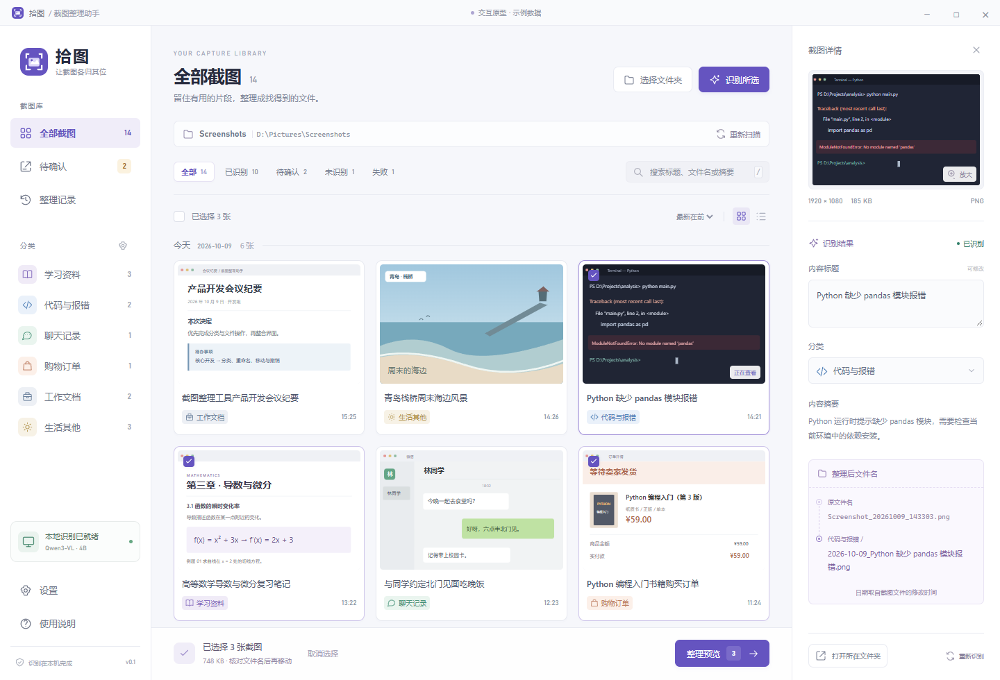

# 拾图 · Screenshot Organizer

Windows 桌面截图整理工具。使用本地视觉模型生成标题、摘要和分类，人工核对后按“日期_内容标题”移动到分类文件夹，支持撤销与中断恢复。

**Local screenshot organization for Windows: recognize, review, preview, move, and undo.**

[](LICENSE)
[](https://github.com/Stewie985211/screenshot-organizer/actions/workflows/windows.yml)



## 功能

- 三栏界面：分类导航、日期分组图库、截图核对面板；支持筛选、搜索标题/文件名/摘要、网格和列表。
- 本机 Ollama + `qwen3-vl:4b-instruct` 生成分类、标题和摘要；模型准备完成后可以离线识别。
- 自定义分类名称、描述和启用状态；允许人工修改标题和分类，待确认项须人工核对。
- 多个来源目录、子文件夹扫描；支持 PNG、JPEG、WebP 和常见非压缩/位掩码 BMP。
- 展示完整移动路径，确认后按分类建立子文件夹、移动和重命名；同名文件追加序号。
- 批次记录、恢复原名和原位置、处理中断后的继续或回滚。
- 模型、缓存、数据库和临时文件保存在项目中；用户选择的截图输出目录可位于 D 盘其他位置。

## 环境与首次启动

### 下载 Windows 便携版

普通用户可到 [Releases 下载已编译的 Windows x64 便携版](https://github.com/Stewie985211/screenshot-organizer/releases/latest)，完整解压到 D 盘，双击“启动截图整理助手.cmd”。AI 识别需要先双击“准备识别环境.cmd”，再在软件中点击“准备本地模型”。无需安装 Node.js 或 pnpm。详见 [便携版使用说明](docs/windows-portable.md)。

### 从源码构建

当前支持 **Windows x64，项目和整理输出放在 D 盘**。开发环境使用 Node.js 24、pnpm 11；具体依赖由 lockfile 固定。本地模型需要可用的内存/显存，较慢的电脑可调整单张识别超时。

在 PowerShell 7 中执行：

```powershell
New-Item -ItemType Directory -Path D:\Projects -Force | Out-Null
Set-Location D:\Projects
git clone https://github.com/Stewie985211/screenshot-organizer.git
Set-Location screenshot-organizer

New-Item -ItemType Directory -Path .cache\temp -Force | Out-Null
$env:TEMP = Join-Path $PWD '.cache\temp'
$env:TMP = $env:TEMP
$env:ELECTRON_CACHE = Join-Path $PWD '.cache\electron'
$env:ELECTRON_BUILDER_CACHE = Join-Path $PWD '.cache\builder'

pnpm install --frozen-lockfile
node node_modules/electron/install.js
pwsh -NoProfile -File scripts/准备本地环境.ps1
pwsh -NoProfile -File scripts/构建.ps1
```

然后双击根目录的 **启动截图整理助手.cmd**。在界面中打开“本地识别”，点击“准备本地模型”；首次需要联网下载运行环境和模型，后续识别使用本机服务。源码仓库不包含模型权重、Ollama 二进制或 Electron 交付包。

`scripts/准备本地环境.ps1` 使用已验证的 Ollama v0.40.2，并校验官方压缩包 SHA256。构建后运行 `pwsh -NoProfile -File scripts/打包便携版.ps1 -SkipBuild` 可生成不含个人数据的发行 ZIP 与 SHA256SUMS.txt，输出到 `output/releases`。

开发时执行 `pnpm build`，再双击 **启动开发版.cmd**。主启动脚本优先使用已打包版本，修改后更新交付包需重新运行构建脚本。

## 日常使用

1. “选择文件夹”→“添加来源文件夹”→“保存来源并扫描”。
2. 点击“开始识别”，等候本地模型生成建议。
3. 点开截图，核对右侧标题和分类；待确认项勾选“我已核对截图内容”，再“确认并加入整理”。
4. 勾选要整理的截图，点击底部“整理预览”，检查新文件名和完整目标路径。
5. 点击“确认整理”，将原文件移动到目标分类目录并重命名。
6. 需要恢复时，在“整理记录”点击“撤销本次整理”。

在“设置”可选择 D 盘上的整理目录，然后“保存设置”。默认是 `output/整理后的截图`；每个分类使用一个子文件夹。可以选择来源里的独立输出子目录，扫描会排除该目录。来源本身、包含来源的目录、盘符根目录和程序运行数据目录不能作为整理目标。

日期来自原文件修改时间，按北京时间解释。扫描、识别和预览不移动原图；“确认整理”执行真实移动。成功整理后保存人工结果，未执行的编辑是本次草稿。详情中的“重新识别”会重新生成建议。当前搜索覆盖文件名、标题和摘要，未实现全文 OCR 或后台自动监听。

## 检查与测试

```powershell
pnpm typecheck
pnpm test
pnpm build
```

核心文件检查共 32 项，使用测试目录内的合成图，覆盖不覆盖移动、撤销冲突、各阶段中断恢复、人工结果持久化、输出位置及扫描排除。

包含 24 张清晰合成截图与边界样本，以及独立监督脚本。它们用来复现问题，不代表真实截图识别准确率。本地模型准备并打包后，可以运行：

```powershell
pnpm test:integration -- --packaged
pnpm test:output
node node_modules/tsx/dist/cli.mjs scripts/layout-smoke.ts
```

模型实验需要本地模型和运行环境，建议串行运行。文件实验使用项目内副本，不以个人原图作为自动测试数据。测试报告写入 `output`，默认不提交。

## 目录与设计原型

```text
src/main/       文件操作、SQLite、模型服务、扫描与恢复
src/preload/    桌面 IPC 桥
src/shared/     类型与分类合同
src/renderer/   正式 React 界面
tests/          核心与保存位置检查
scripts/        构建、运行环境准备与桌面实验
assets/         可复现的合成截图
ui-design/      独立界面设计源与交互原型
docs/           使用、架构与验证说明
```

独立原型使用合成数据，构建命令为 `node ui-design/scripts/build.mjs`，输出为 `ui-design/output/拾图-交互原型.html`。正式程序始终通过 IPC 调用实际业务。详见 [架构](docs/architecture.md)、[文件安全与验证](docs/validation.md) 和 [贡献指南](CONTRIBUTING.md)。

## 文件安全与边界

- 不覆盖已有文件；文件发布前校验内容，遇到重名追加序号。
- 输出和撤销目的地需支持硬链接，当前主要验证范围是 D 盘 NTFS。
- 原位置被占用或图片后来被修改时，保留文件并报告冲突。
- 常见 BMP 可读取；RLE 压缩 BMP 暂不支持。
- 本地模型可能判断错误，移动前应核对标题、分类和路径。
- 不要单独搬走 `output/desktop/win-unpacked`；应用需要根目录标记、`tools` 与 `data/models`。迁移整个目录后重新选择来源/输出，旧历史仍使用原绝对路径。

## 许可证

项目原创源码和合成样本以 [MIT](LICENSE) 发布。第三方组件与模型遵守各自许可证，见 [第三方说明](THIRD_PARTY_NOTICES.md)。
